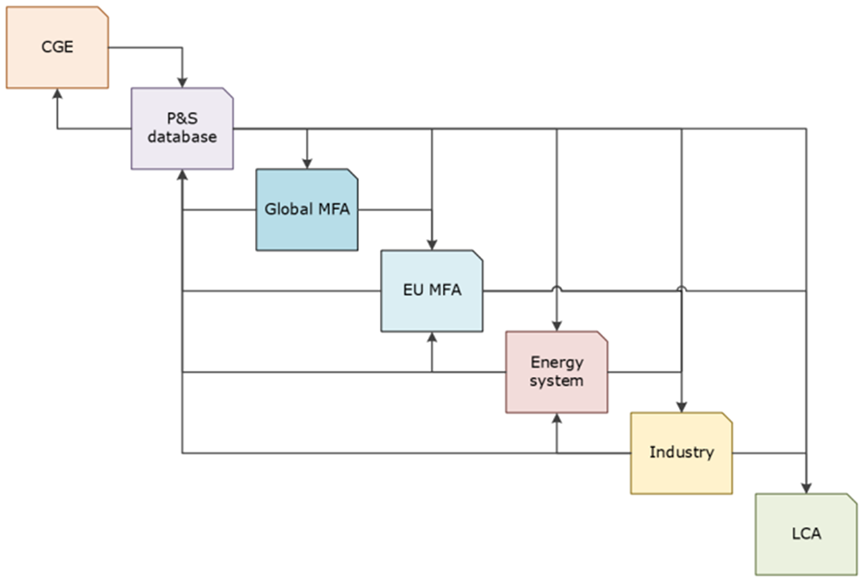

# Integration into MIC3

The model interconnections within MIC3 are shown in Figure 1. These relationships are described in detail in [D3.3 and D3.4 of the project](https://www.transience.eu/publications/deliverables).
The trade flows of REMIND-MFA are delivered especially to the [EU-MFA](https://transience-eu-mfa.readthedocs.io/) module. REMIND-MFA material flows within Europe are harmonised with those delivered by the EU-MFA module. This enables MIC3 to anchor its European scenarios within a broader international system, accounting for interregional dynamics and trade-related impacts on competitiveness, imports, and exports.


*Figure 1: Planned interfaces in the MIC3 baseline workflow*

## Inputs from other modules
| Parameter                                   | Source   | Description                                                                                                   |
|---------------------------------------------|----------|---------------------------------------------------------------------------------------------------------------|
| Trade flows                                 | OPEN-GEM | For harmonization of EU trade flows of manufactured products and steel scrap, via the relative change of OPEN-GEM trade ratios (see below) |
| EU material demands and EoL flows           | EU-MFA   | For harmonization of flows within the EUR region between EU-MFA and EU region in REMIND-MFA                                         |
| Production costs                            | FORECAST-Sites | For informing supply cost curves in the price-sensitive Armington trade model ATLAS coupled to REMIND-MFA                |

## Outputs to other modules
| Parameter                                   | Sink     | Description                                                                                                   |
|---------------------------------------------|----------|---------------------------------------------------------------------------------------------------------------|
| Trade flows                                 | EU-MFA   |   |
| Trade flows                                 | OPEN-GEM | For harmonization of trade flows between OPEN-GEM and REMIND-MFA |

## Alignment of EU trade with OPEN-GEM

OPEN-GEM reports sectoral trade in monetary terms (b$ 2017). Since the sectors do not match the
REMIND-MFA goods 1:1 and the material intensity of the economic value can change, the monetary
flows are not translated into tonnes. Instead, the EU (`EUR`) trade ratios of REMIND-MFA follow the
relative change of the OPEN-GEM trade ratios from a base year (`transience.open_gem_base_year`,
default 2025) on (`OpenGemTradeAligner`):

| Model    | Market                  | Ratio (MFA)               | Ratio (OPEN-GEM, EU27)                |
|----------|-------------------------|---------------------------|---------------------------------------|
| steel    | `manufactured_products` | imports, exports / demand | `IMPORTS`, `EXPORTS` / `DEMAND`, per end use |
| steel    | `scrap`                 | imports, exports / collected scrap | `IMPORTS`, `EXPORTS` / `PROD` of IND19 |
| plastics | `manufactured_products` | imports, exports / demand | `IMPORTS`, `EXPORTS` / `DEMAND`, per end use |

The trade in the base year comes from the usual trade extrapolation, and the other regions absorb
the change of the EU trade, so global trade stays balanced. The OPEN-GEM sectors are assigned to
the REMIND-MFA goods by `sector_mapping_OPEN_GEM.xlsx`. Plastics waste trade is a scenario
parameter and is not aligned. The physical limits of steel scrap use are applied after the
alignment and may still change the EU scrap trade.

The OPEN-GEM scenarios match the TRANSIENCE (EU-MFA) scenarios, so `transience.transience_scenario`
selects both. To run with the alignment:

1. Convert the OPEN-GEM report to `.cs4r` files next to the EU-MFA files of each scenario, in
   `data_in/legacy/transience/<transience_scenario>/`:

    ```bash
    uv run python scripts/map_OPEN-GEM_trade.py
    ```

    `SCENARIOS` in the script assigns each TRANSIENCE scenario its OPEN-GEM scenario, i.e. the sheet
    `SECTOR_<OPEN-GEM scenario>` of the report. Add new scenarios there. A different report file
    can be passed with `--report`.
2. Set `open_gem_alignment = true` in the `[<model>.transience]` section of the config. The run
   folder name gets the suffix `_OPEN-GEM`.

## Coupling with the ATLAS trade model

Trade is normally extrapolated from historic trade (`TradeExtrapolator`). Alternatively, it can be
calculated by the ATLAS trade model, which needs the material demand of REMIND-MFA as input.

Make sure you have `pixi` installed (e.g., `curl -fsSL https://pixi.sh/install.sh | sh`).

Run the complete workflow with the MFA-ATLAS-MFA coupling:

```bash
uv run atlas.py couple --model steel
```

`couple` runs MFA with `default,atlas_run1`, copies demand to the data pipeline, runs the ATLAS data pipeline, calibration, validation, and the ATLAS future model, transfers the resulting trade, then runs MFA
with `default,atlas_run2`.

Each stage can also be retried or run independently:

```bash
# Run the first MFA stage
uv run atlas.py run-mfa --model steel --stage one
# Copy the generated demand trajectories to the ATLAS data pipeline
uv run atlas.py copy-demands --model steel
# Run the ATLAS data pipeline to generate trade flows
uv run atlas.py preprocess
uv run atlas.py calibrate
uv run atlas.py validate
uv run atlas.py future
# Copy the generated trade flows back to REMIND-MFA
uv run atlas.py copy-trade
# Run the second MFA stage with the new trade flows
uv run atlas.py run-mfa --model steel --stage two
```

Note: `future` and `couple` accept a few options to control the ATLAS variant, CO2 price, and PkBudg scenario. See `atlas.py future --help` for details. If you pass any of these options, you must also pass them to `copy-trade` so that the correct ATLAS cache is read.

A few more details on the coupling:

1. `uv run remind-mfa --config default --config atlas_run1 --model steel` writes the material
   demand of the traded product to `<export.path>/atlas/` (`steel_demand.csv` per region and year,
   `plastics_demand.csv` additionally per polymer). Trade is extrapolated in this run.
2. ATLAS is run on that demand, and its trade output is converted to the input data format of
   REMIND-MFA, i.e. to one `.cs4r` file per market and trade direction in the input data folder:

    | Model    | Market    | Files                                                          |
    |----------|-----------|----------------------------------------------------------------|
    | steel    | `steel`   | `st_trade_steel_imports.cs4r`, `st_trade_steel_exports.cs4r`     |
    | plastics | `primary` | `pl_trade_primary_imports.cs4r`, `pl_trade_primary_exports.cs4r` |

    The files carry the dimensions of the corresponding trade market in their header line, i.e.
    `* note: dimensions: (Time,Region,value)` for steel and
    `* note: dimensions: (Time,Region,Polymer,value)` for plastics.

3. `uv run remind-mfa --config default --config atlas_run2 --model steel` reads those files
   instead of extrapolating trade (`trade.source = "data"`). Historic years still use the trade of
   the historic MFA, so only future years come from ATLAS. By default, ATLAS projects in 5-year
   steps. Other future years are later interpolated linearly. Global imports and exports of the data are balanced
   (`trade.balance`).

By default, only the primary market of each material is read from data. Other markets (e.g. steel
scrap or indirect trade) can be added with `trade.data_markets`.
